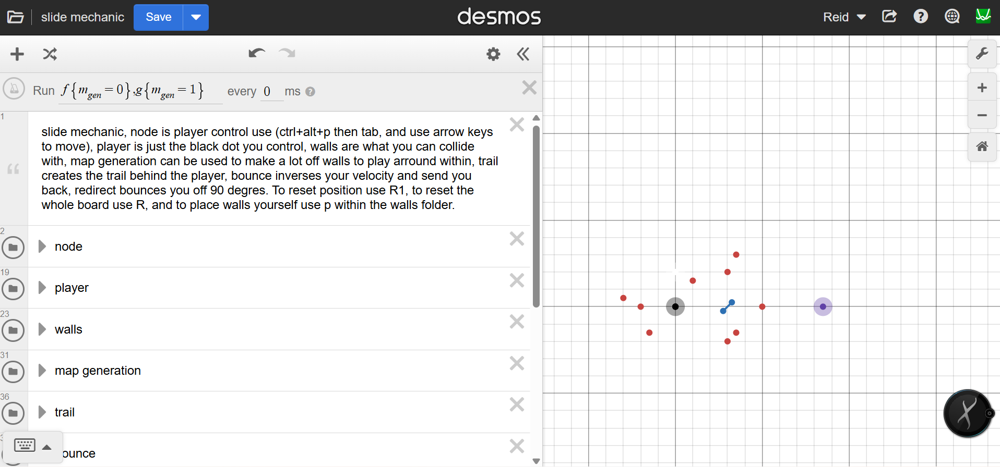

# desmos-slide-logic
The game is a simple editor currently, where you can move a player around with the arrow keys, and it can collide with walls and interact with mechanics.

There isn't any code here because it is all on Desmos.

## Try it: 
https://www.desmos.com/calculator/eywwhcn1ad 

## Quick start
Controls - first press (Ctrl+Alt+P), then (Tab), then you can use the arrow keys to move the player. If you click somewhere or type something, you might have to re-lock on to the player by  pressing (Ctrl+Alt+P) then (Tab).

## Features:
- custom wall placement
- bounce walls
- redirect wall

## what I learned / how it works
- had to learn/use Perseywise logic {condition:True, False}
- it uses a ticker for physics steps and FPS
- you have to have a control node for there to be collisions

> Note: sadly it cannot be run locally, as it uses Desmos as the game engine, which means the graph is accessed from their servers. 

## credits:
Created by me - robopugo - no10123
Created for StarDance hack club challenge
